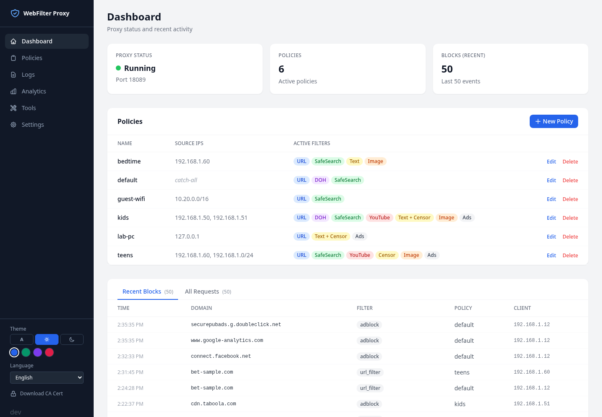
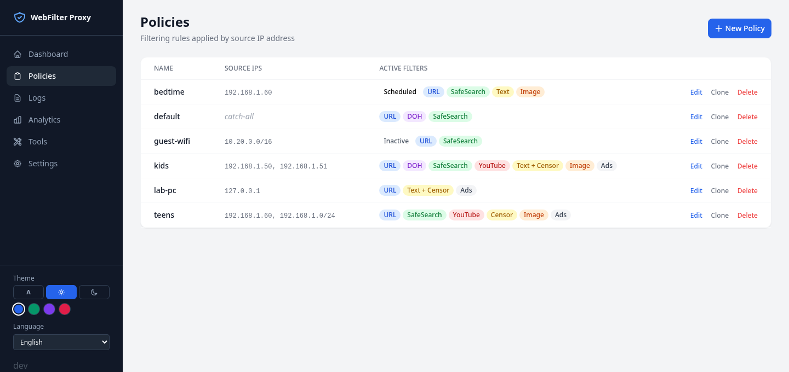
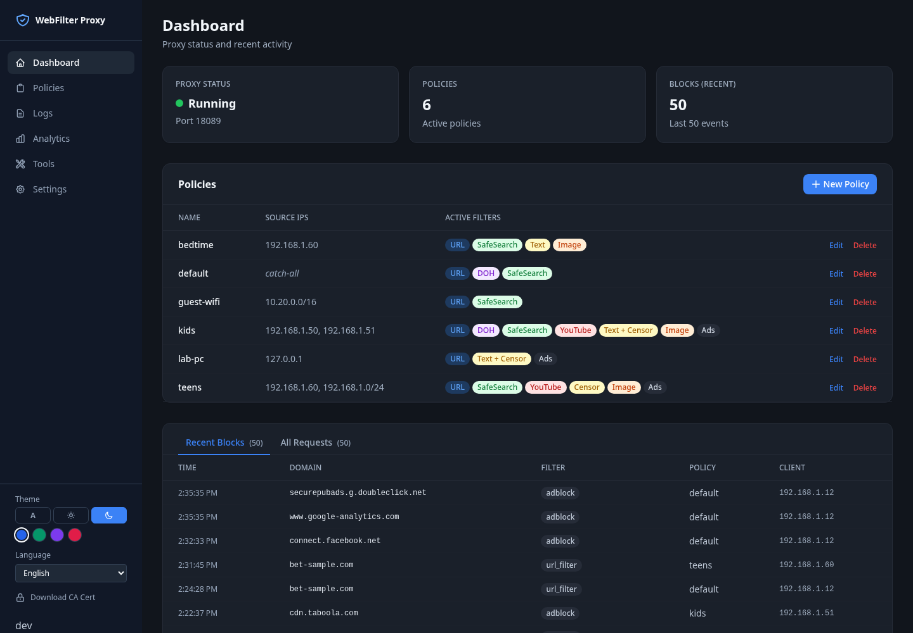
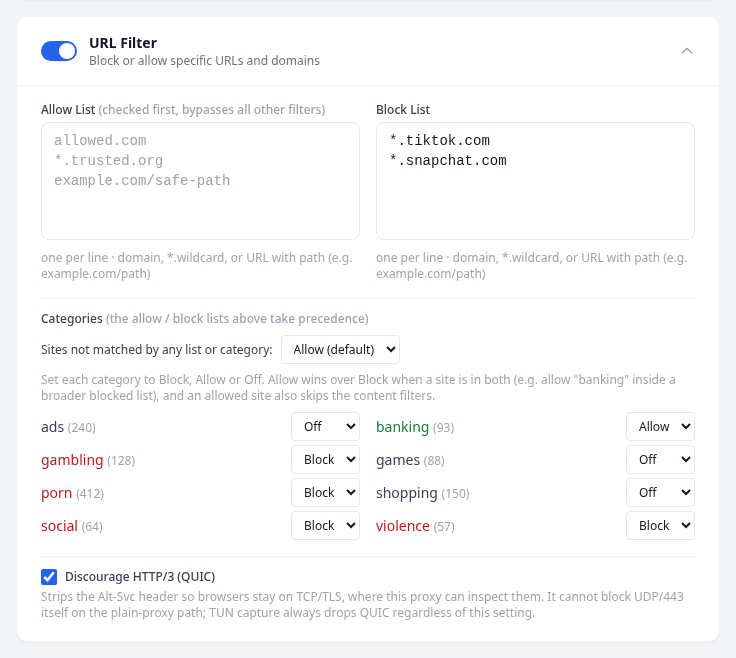
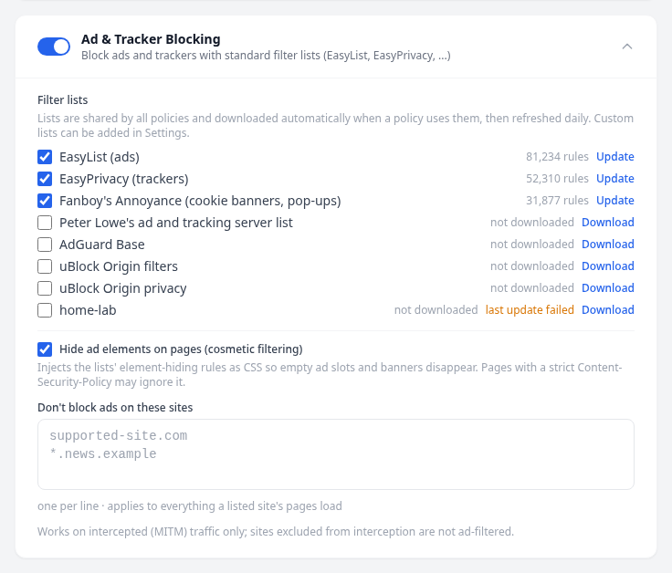
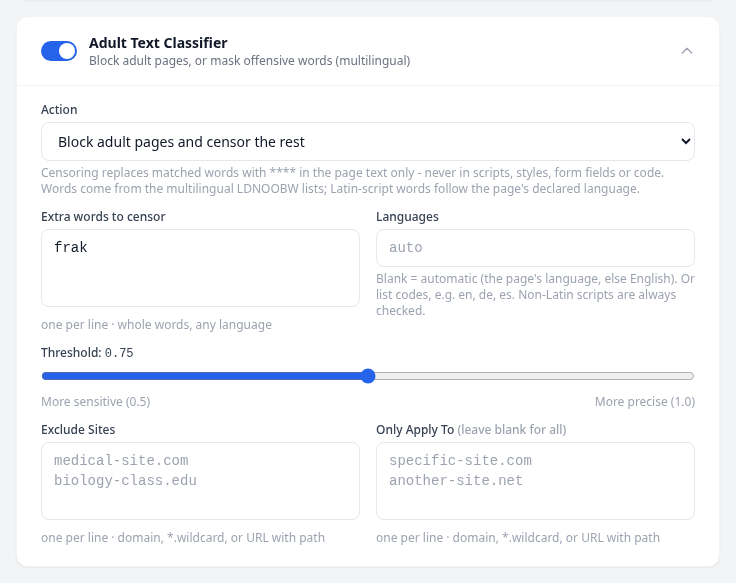
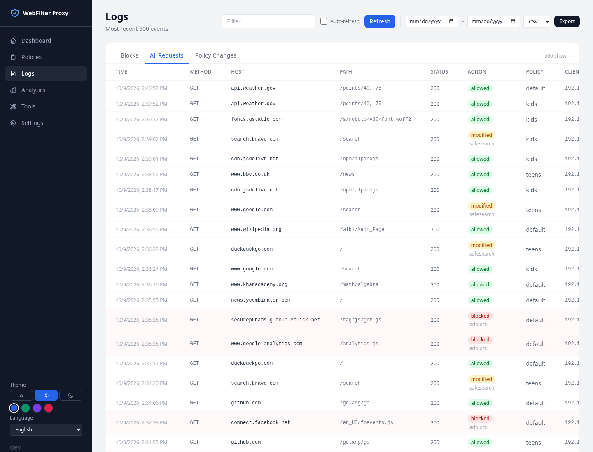
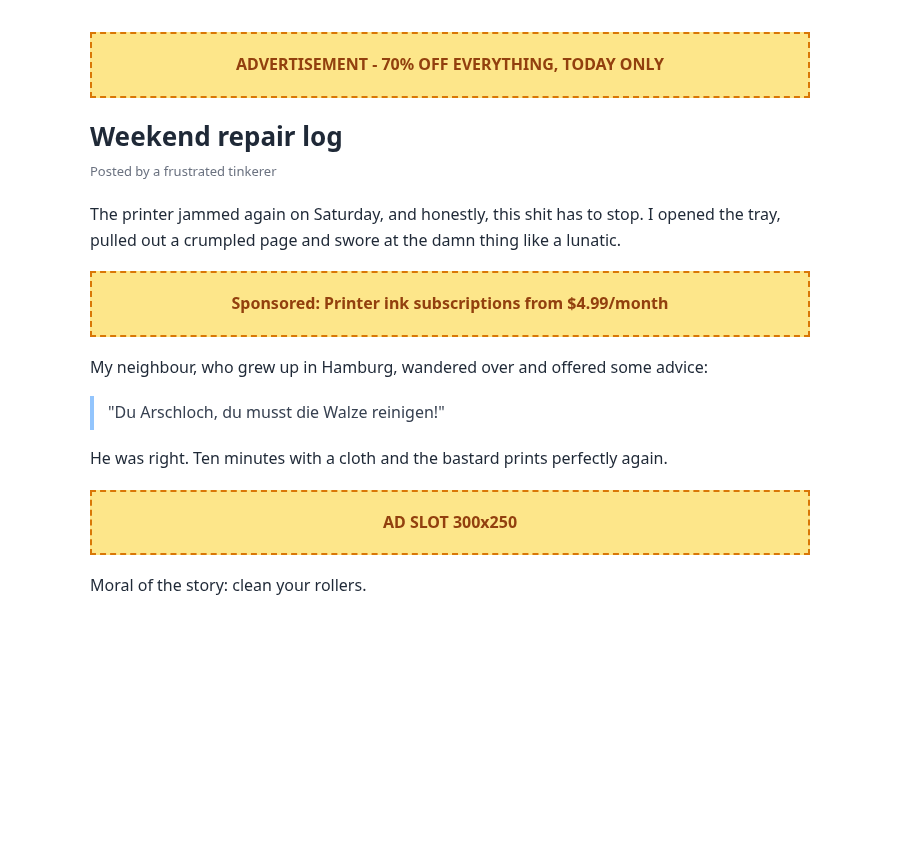
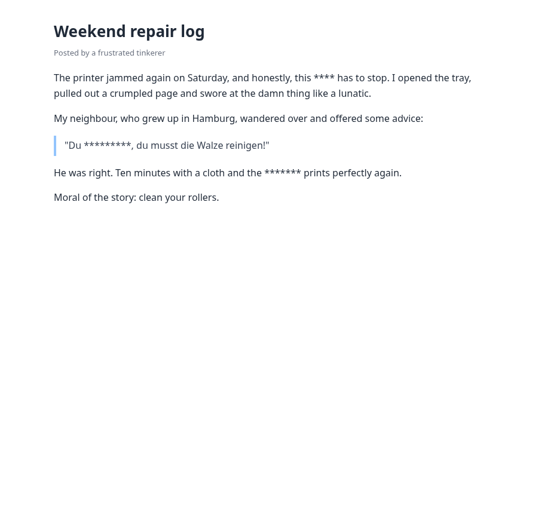

# gowebfilter

A single-binary parental-control web filter, written in Go. Download it, run
it, and manage it from your browser.

It MITM-intercepts HTTP/HTTPS traffic, matches each client (by MAC, IP or
CIDR range) to a filtering policy, and ships a browser-based management UI.
It is a from-scratch Go port of
[mitmproxy-web-filter](https://github.com/Yjlion/mitmproxy-web-filter),
replacing a Python + mitmproxy runtime with one static executable.

- **Single binary, nothing to install.** Written in Go; just download and
  run it. No Python, no native ML runtime, no sidecar libraries.
- **Lightweight.** The binary is about 30 MB. Memory use is about 50 MB
  idle and roughly 150-220 MB with the image classifier busy (measured on
  Linux x86_64), so it runs well on small machines: a Raspberry Pi, a small
  VM, or your desktop's localhost.
- **Built for parental control, not as a general proxy server.** There are
  no complicated ACLs and no policy ordering. Each client's IP or MAC is
  matched to one policy; the only ordering is that a single IP wins over an
  IP range.
- **Poor man's classification.** Every policy can query a DoH
  (DNS-over-HTTPS) endpoint, so you can lean on another service's
  filtering instead of downloading and maintaining large blocklists. The
  standard blocklists are supported too if you want them.
- **Android without hacks.** The Android app does no tricks to enforce
  itself. Lock it down with an EMM/MDM instead.

> **Vibe-coded disclaimer.** This project was built almost entirely through
> AI-assisted sessions, with a human reviewing direction and testing rather
> than writing most of the code by hand. It has real test coverage and has
> been exercised against live traffic, but it has not had an independent
> human security audit. Treat it as a personal/homelab project, not audited
> security software.

## Scope: a proxy, not an enforcer

gowebfilter is the proxy server and nothing more. It does not currently try
to force traffic through itself. Every platform (Windows, macOS, Linux) and
every deployment mode (localhost, LAN, bridge, transparent) has its own
enforcement story, and each needs its own development and testing track.
There are not the resources for that at the moment.

What it does give you is flexibility. The proxy supports several listener
modes: regular, SOCKS4/5, transparent (Linux), ICAP for use behind Squid, and
TLS-wrapped variants. That means it can be integrated with any firewall or
redirection method you already use: point your firewall's redirect rules,
a PAC file, a gateway, or an existing proxy at the listener that fits.

You are welcome to do the integration yourself for your setup, and
documentation contributions are especially appreciated. The
[packaging notes](packaging/README.md) and [Docker guide](docs/docker.md)
cover what exists today (systemd units, a Windows service, optional
tun2socks capture, and a Linux gateway mode).

This is a CLI application with a web interface. There is no native desktop
UI.

## Screenshots

All captures are in [screenshots/](screenshots/) (see its README for the
full list), rendered against generated sample data. Regenerate with
`bash scripts/capture_screenshots.sh`.

[](screenshots/)

| | |
|---|---|
| [](screenshots/policies.png) Policies | [](screenshots/dashboard-dark.png) Dark theme |
| [](screenshots/editor-url-filter.png) Per-category block / allow / off | [](screenshots/editor-adblock.png) Ad & tracker blocking |
| [](screenshots/editor-text-classifier.png) Text classifier: block, censor or both | [](screenshots/logs-requests.png) Request log |
| [](screenshots/censor-before.png) A page as published... | [](screenshots/censor-after.png) ...and through the proxy: words censored, ads hidden |
| [](screenshots/image-blur-before.png) Images as published... | [](screenshots/image-blur-after.png) ...and through the proxy: flagged images blurred (see note below) |

The image-blur captures use harmless generated artwork, with the policy's
image threshold set to 0 so every image is flagged. They show what the blur
looks like, not what the classifier scores.

## What it does

- **TLS-intercepting forward proxy**: generates its own CA, issues per-host
  leaf certificates on the fly, and filters decrypted HTTP/HTTPS traffic
  through an ordered addon pipeline.
- **Per-client policy routing**: policies match by MAC address, exact IP,
  CIDR range, or a catch-all default. The most specific match wins: MAC,
  then single IP, then IP range, then the default. There is no rule
  ordering to manage.
- **Filtering addons**: URL allow/block lists plus shared category lists,
  each set to block, allow or off per policy (so "banking: allow" can carve
  banks out of a broader blocked list); ad and tracker blocking from
  standard filter lists (EasyList, EasyPrivacy, uBlock/AdGuard lists, hosts
  files) with element hiding; SafeSearch enforcement; YouTube channel
  filtering; DNS-over-HTTPS blocking; QUIC blocking; an embedded pure-Go
  adult-text classifier that can block pages or censor offensive words in
  ~28 languages; and a pure-Go embedded NSFW image classifier.
- **ICAP service**: an `icap@host:port` listener turns the same filtering
  into an adaptation service for a proxy you already run — Squid keeps its
  caching, ACLs, auth and TLS interception and hands each request and
  response over for a verdict. Verified against Squid in forward, ssl_bump,
  peek-and-splice and transparent-intercept modes; see
  [docs/icap.md](docs/icap.md).
- **Management UI**: policy editor, live logs/analytics, PAC file
  generation, neighbor/ARP scanning, and category list management.
- **Single binary**: no Python runtime, virtualenv, native ML runtime, or
  sidecar DLL to bundle; cross-compiles for Windows and Linux
  (x86_64/arm64) with `CGO_ENABLED=0`.
- **DoH-based classification**: each policy can point at a DNS-over-HTTPS
  resolver (for example a family-filtering DNS service) and treat its answer
  as the verdict, so you do not have to download and maintain big
  blocklists.

## Quick start

Building does not require CGO or a C toolchain.

```bash
go build -o webfilter.exe ./cmd/webfilter   # or `webfilter` on Linux

cp config/settings.example.json config/settings.json
cp policies/default.json.example policies/default.json

./webfilter.exe run --settings config/settings.json
```

Then open `http://127.0.0.1:8000` for the management UI, and point clients
at `127.0.0.1:8080` as their HTTP(S) proxy. Import `certs/ca.crt` into the
client's trust store to avoid TLS warnings once MITM starts intercepting.

`run` starts both the proxy engine and the management server in one
process. `webfilter proxy` and `webfilter mgmt` run them standalone if you
want process isolation.

### In a container

```bash
docker compose up -d
```

The image is a static binary on Alpine, and the container bootstraps its own
`config/`, `policies/`, `certs/` and `logs/` into a single `/data` volume on
first start — there is nothing to copy first. See
[docs/docker.md](docs/docker.md) for the CA-install and blocklist steps.

## Building and testing

```bash
CGO_ENABLED=0 go build ./...
go vet ./...
go test ./...
```

See [HANDOFF.md](HANDOFF.md) for the full phase-by-phase build history,
what is verified vs. not, and architecture notes for anyone picking this
project back up. See [packaging/README.md](packaging/README.md) for running
it as a Windows service or Linux systemd unit.

## Models

- **Image (GantMan/nsfw_model)**: no setup needed. The model
  ([MobileNetV2, MIT-licensed](https://github.com/GantMan/nsfw_model)) is
  embedded directly in the binary (`internal/classify/image/model.bin`,
  ~8.6MB) and run by a from-scratch pure-Go inference engine. See
  `scripts/nsfw-model/README.md` for provenance and regeneration notes.
- **Text (embedded Bayesian scorer + multilingual word lists)**: no setup
  needed. A compact adult-text feature table is embedded in the binary and
  scored with a pure-Go Naive Bayes classifier, and every language list
  from [LDNOOBW](https://github.com/LDNOOBW/List-of-Dirty-Naughty-Obscene-and-Otherwise-Bad-Words)
  (CC-BY-4.0) is embedded for the censor mode and as low-weight scorer
  evidence. See [docs/text-classifier.md](docs/text-classifier.md) and the
  `NOTICE` files in `internal/classify/textbayes` and
  `internal/classify/profanity`.
- **Ad/tracker filter lists**: not embedded. Lists a policy uses are
  downloaded at runtime and refreshed daily; see
  [docs/adblock.md](docs/adblock.md).

Enable `image_classifier`/`text_classifier` on the policies that should use
them. Both default to disabled per-policy because NSFW classification false
positives have real cost and should be an explicit opt-in.

## Configuration

Config lives entirely on disk, matching the Python original's layout:

- `config/settings.json` - global settings. Most changes apply immediately;
  `PUT /api/settings` reports which ones still need a restart (see below).
  Set `mgmt_tls` to serve the management UI over HTTPS (below).
- `policies/*.json` - per-client policies. Hot-reloaded; edit via the UI or
  the file directly.
- `certs/` - generated CA + leaf certificate cache.
- `categories/` - domain-list blocklists refreshed by
  `webfilter categories update`.
- `adblock/` - downloaded ad/tracker filter lists (`adblock.dir` in
  settings), refreshed automatically or with `webfilter adblock update`.
- `logs/webfilter.db` - SQLite request/block log, browsable from the UI.

Runtime state is generated or copied from the shipped `.example` templates
and is not committed to the repo.

### What reloads without a restart

Policies hot-reload wholesale. Settings reload the fields whose consumers
read them per request - interface language, proxy authentication, the
management pseudo-hostname, ICAP tuning, PAC settings, management auth, the
adblock list directory and custom lists - and
the API tells you about the rest rather than making you guess:

```json
PUT /api/settings  ->  { ..., "restart_required": ["proxy_listen"] }
```

Still restart-only, because they are bound or opened once at startup:
`proxy_listen`, `mgmt_host`/`mgmt_port`, `cert_dir`, `logs_dir` and the
`log_*` options, `policies_dir`, and the `tun2socks`/`gateway` capture
modes. The settings page names them after a save.

This works whether the proxy and management server share a process
(`webfilter run`) or not: a standalone `webfilter proxy` picks up changes
written by a standalone `webfilter mgmt` through a filesystem watch.

### Management HTTPS

`mgmt_tls` serves the management UI and API over TLS, including the login
request. The certificate is either a pair you supply
(`mgmt_cert_file`/`mgmt_key_file` - the path for a publicly trusted
certificate) or one minted on demand by the runtime CA, the same issuer the
proxy uses for TLS-wrapped listeners.

One consequence of the CA-minted option is worth knowing before enabling
it: the CA download at `/api/ca-cert` is then itself served over HTTPS
signed by the CA the client has not installed yet, so the first fetch warns.
WPAD clients will likewise not fetch `/proxy.pac` from an endpoint they do
not trust. Install `certs/ca.crt` out of band first, supply a real
certificate, or leave `mgmt_tls` off if you distribute PAC from this port.

The Android app always serves its management UI over plain loopback HTTP
regardless of this setting - its WebView has no trust path to a CA-minted
leaf.

## URL filter categories

Shared category lists (`webfilter categories update`, or per-category
downloads on Android) are set per policy in `url_filter.category_actions`:

```json
"url_filter": {
  "enabled": true,
  "mode": "blacklist",
  "category_actions": { "porn": "block", "gambling": "block", "banking": "allow" }
}
```

A category that is absent is off. `mode` is the default for sites nothing
matched: `blacklist` lets them through (the default), `whitelist` blocks
them. A request is decided by the first of these that matches:

1. the custom `allow` list (then the content filters are skipped too),
2. the custom `block` list,
3. an `allow` category (also skips the content filters - useful for
   banking or school sites),
4. a `block` category,
5. `mode`.

Older policy files with a plain `categories` list keep working: on load each
listed category becomes `block` in blacklist mode or `allow` in whitelist
mode, exactly what the list meant before. (A whitelist policy that listed no
categories never blocked anything, so it loads as blacklist.)

## Monitoring

The management server exposes two endpoints for operations:

- `GET /health` - liveness for load balancers and container healthchecks.
  Unauthenticated (a load balancer cannot log in) and deliberately cheap: no
  database queries, no port probes.
- `GET /metrics` - Prometheus text exposition: requests by action, blocks by
  component, classifier latency and outcomes, upstream errors, connection
  counts. No external exporter and no new dependencies.

See [docs/metrics.md](docs/metrics.md) for the full metric list, how to
scrape it when management auth is on, and the one real caveat (counters are
per-process, so scrape the process that serves traffic).
